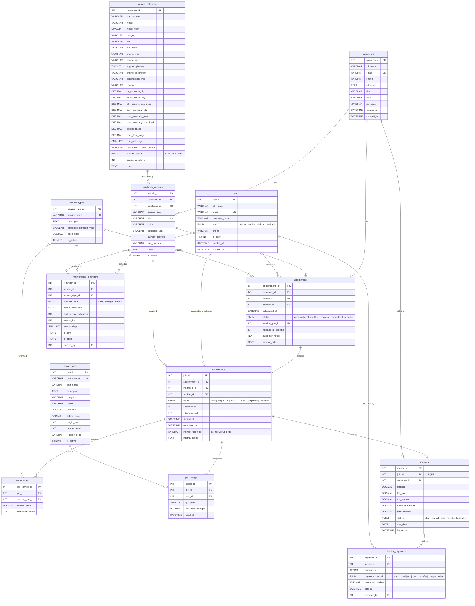

# AutoCare Insight — ER Diagram

## Entity-Relationship Diagram

---

## Relationship Summary

| Parent Entity | Child Entity | Cardinality | FK Column | ON DELETE |
|---------------|-------------|-------------|-----------|-----------|
| customers | customer_vehicles | 1:M | customer_id | RESTRICT |
| vehicle_catalogue | customer_vehicles | 1:M | catalogue_id | SET NULL |
| customers | appointments | 1:M | customer_id | RESTRICT |
| customer_vehicles | appointments | 1:M | vehicle_id | RESTRICT |
| users (advisor) | appointments | 1:M | advisor_id | SET NULL |
| service_types | appointments | 1:M | service_type_id | SET NULL |
| appointments | service_jobs | 1:0..1 | appointment_id | SET NULL |
| users (mechanic) | service_jobs | 1:M | mechanic_id | SET NULL |
| customer_vehicles | service_jobs | 1:M | vehicle_id | RESTRICT |
| service_jobs | job_services | 1:M | job_id | CASCADE |
| service_types | job_services | 1:M | service_type_id | RESTRICT |
| service_jobs | part_usage | 1:M | job_id | RESTRICT |
| spare_parts | part_usage | 1:M | part_id | RESTRICT |
| service_jobs | invoices | 1:0..1 | job_id (UNIQUE) | RESTRICT |
| customers | invoices | 1:M | customer_id | RESTRICT |
| invoices | invoice_payments | 1:M | invoice_id | RESTRICT |
| users (staff) | invoice_payments | 1:M | recorded_by | SET NULL |
| customer_vehicles | maintenance_reminders | 1:M | vehicle_id | CASCADE |
| service_types | maintenance_reminders | 1:M | service_type_id | SET NULL |
| users | maintenance_reminders | 1:M | created_by | SET NULL |

---

## MongoDB Relationship

The `service_jobs` table stores the MongoDB `_id` as a 24-character hex string in `mongo_report_id`. The MongoDB document stores the MySQL `job_id` as an integer for bidirectional lookup.
